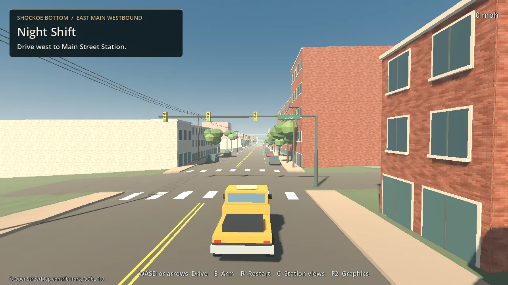
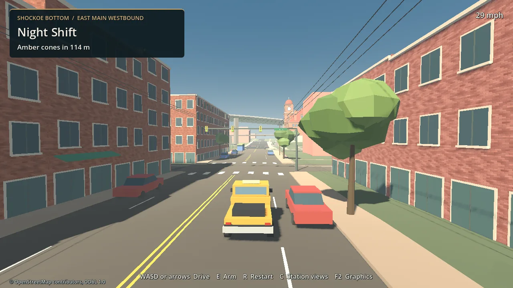
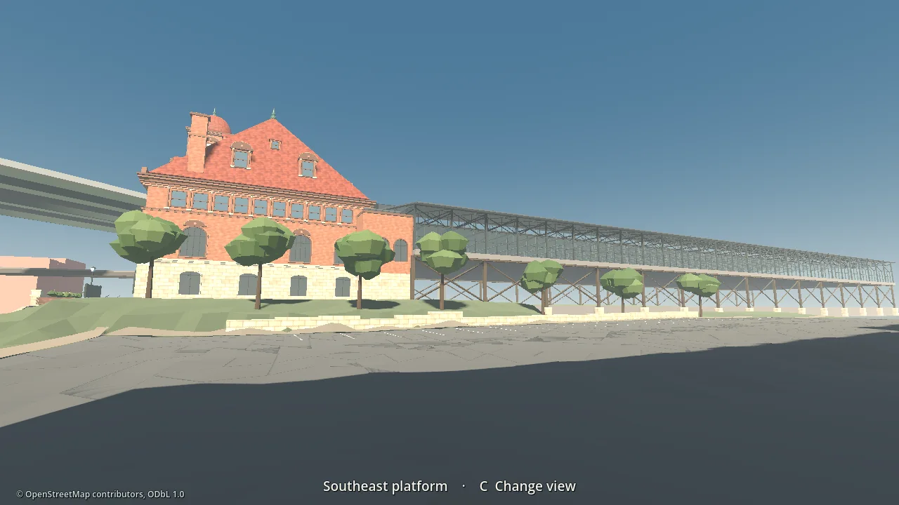

# Godot station trial

The trial starts the maintenance truck just east of 21st Street. Drive west through Shockoe Bottom toward the station and its rail and freeway approaches. `E` arms the striper. Drive through the amber cones and follow the lane to the green cones. `R` restarts the drive. `C` cycles through the southwest entrance, southeast platform and driving camera. `F2` toggles lower scene resolution and disables real-time shadows in Low mode. The HUD shows live FPS while driving.








The update uses both street views supplied by the user as visual references. The southeast view now shows the east-facing dormers, brick connector, dark roof overhang and the shed's glass band over an exposed steel trestle. Limestone segments around the lower entrance give the southwest view deeper joints and more relief. The lot, trees and trestle details are visually fitted approximations.

The driving model samples the imported road elevation as the truck moves. It uses arcade steering and follows the mapped corridor. OSM provides the street alignment and intersections. The terrain extends the existing 2025 raster DEM and shares its exact seam at local northing zero. Original façades, awnings, parking, street trees, signals and a bus shelter interpret the two sets of views. Road widths and decorative placements are approximate. Parked cars and the bus are stationary. [Corridor evidence](../reports/east_main_corridor.json)

## Play

- Windows 64-bit. Extract the package and run `RVA-Night-Shift.exe`.
- Linux x86-64. Run `RVA-Night-Shift.x86_64` from the release export.
- Web. Serve the contents of the web export over HTTP or HTTPS and open `index.html` in a WebGL 2 browser. The trial uses the Compatibility renderer and a single-threaded export. [Godot web export guide](https://docs.godotengine.org/en/stable/tutorials/export/exporting_for_web.html)

## Rebuild

Start with the assembled Blender scene from [East Main Street](Station_Approach_Preview.md). This exports the existing station materials and crops the surrounding terrain. The scene uses meters with the station crossing as the horizontal origin.

```sh
python tools/run_task.py S1-13 -- python tools/build_east_main_corridor.py
python tools/run_task.py S1-11 -- blender -b outputs/station-approach/RVA_Station_Approach.blend \
  --python-exit-code 1 --python tools/export_godot_station.py
godot --headless --path godot/station_trial --editor --import
godot --headless --path godot/station_trial --fixed-fps 60 --script res://verify_trial.gd
mkdir -p outputs/godot-trial/windows
godot --headless --path godot/station_trial --export-release Windows \
  "$PWD/outputs/godot-trial/windows/RVA-Night-Shift.exe"
```

The export requires Godot 4.7.2 with matching export templates. Use the existing `Linux` and `Web` presets for those targets. Blender assets use the same data as the station preview, including © OpenStreetMap contributors (ODbL 1.0) and the local NOAA/USGS terrain evidence. [Pilot data sources](Pilot_Data_Contract.md) · [Godot license](https://godotengine.org/license/)

The engine test raycasts the westbound pavement every six meters on the new segment, drives from 21st Street to the station, and completes the stripe. It also checks the inspection cameras, graphics toggle and restart. Use the weakest intended device to validate the 720p and 30 FPS trial goal.

## Streamed GIS survey

The separate Richmond GIS pilot covers the saved Shockoe and Church Hill snapshot. It shows NAIP aerial imagery, generated building volumes and a survey camera with pan, orbit and zoom. The GIS coverage is suitable for checking placement, scale and height alongside the authored drive. [In-engine survey](../reports/RVA_GIS_Pilot.webp)

From the Godot editor, run `res://tools/assemble_gis_pilot.gd` after importing the building GLBs in `res://assets/rva_gis/meshes/`. The assembler uses the existing GIS folder at `outputs/rva_gis`; set the `RVA_GIS_DATA_DIR` environment variable before opening Godot to use a smaller saved snapshot. The chunk manifest must match that snapshot. Open or run `res://assets/rva_gis/pilot/richmond_gis_pilot.tscn`. Pan with WASD or the arrow keys, drag with the right mouse button to orbit and scroll to zoom.

Terrain and collision use the same R16 samples and NW–SE diagonal. Aerial textures take a small collar around each tile to preserve filtering at cell edges. Each building layer brings in the terrain it overlaps. The survey loads and retires layers as the camera moves. Road and bike splines are scene data for future routing. Tagged bridges, tunnels and nonzero-layer ways are recorded for later elevation work. Side offsets for tagged bike lanes use road-width estimates.

The audit camera accepts this scene. Point `RVA_AUDIT_GIS_DIR` at the GIS snapshot used to generate it and run `res://tools/visual_audit_cam.gd` from the editor. The camera brings the appropriate layers in for each viewpoint. The Night Shift exports exclude the generated GIS resources to keep their download size independent of map coverage.
