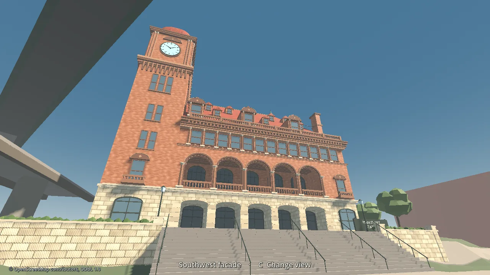

# Godot station trial

The trial starts the maintenance truck just east of 21st Street. Drive west through Shockoe Bottom toward the station and its rail and freeway approaches. `E` arms the striper. Drive through the amber cones and follow the lane to the green cones. `R` restarts the drive. `C` cycles through the southwest entrance, southeast platform and driving camera. `F2` toggles lower scene resolution and disables real-time shadows in Low mode. The HUD shows live FPS while driving.





The update uses both street views supplied by the user as visual references. The southeast view now shows the east-facing dormers, brick connector, dark roof overhang and the shed's glass band over an exposed steel trestle. Limestone segments around the lower entrance give the southwest view deeper joints and more relief. The lot, trees and trestle details are visually fitted approximations.

The driving model samples the imported road elevation as the truck moves. It uses arcade steering and follows the mapped corridor. OSM provides the street alignment and intersections. The terrain extends the existing 2025 raster DEM and shares its exact seam at local northing zero. Original façades, awnings, parking, street trees, signals and a bus shelter interpret the two sets of views. Road widths and decorative placements are approximate. Parked cars and the bus are stationary. [Corridor evidence](../reports/east_main_corridor.json)

## Play

- Windows 64-bit. Extract the package and run `RVA-Night-Shift.exe`.
- Linux x86-64. Run `RVA-Night-Shift.x86_64` from the release export.
- Web. Serve the contents of the web export over HTTP or HTTPS and open `index.html` in a WebGL 2 browser. The trial uses the Compatibility renderer and a single-threaded export. [Godot web export guide](https://docs.godotengine.org/en/stable/tutorials/export/exporting_for_web.html)

## Rebuild

Start with the assembled Blender scene from [East Main Street](Station_Approach_Preview.md). This exports the existing station materials and crops the surrounding terrain. The scene uses meters with the station crossing as the horizontal origin.

```sh
python tools/run_task.py S1-13 -- python tools/build_east_main_corridor.py
python tools/run_task.py S1-11 -- blender -b outputs/station-approach/RVA_Station_Approach.blend \
  --python-exit-code 1 --python tools/export_godot_station.py
godot --headless --path godot/station_trial --editor --import
godot --headless --path godot/station_trial --fixed-fps 60 --script res://verify_trial.gd
mkdir -p outputs/godot-trial/windows
godot --headless --path godot/station_trial --export-release Windows \
  "$PWD/outputs/godot-trial/windows/RVA-Night-Shift.exe"
```

The export requires Godot 4.7.2 with matching export templates. Use the existing `Linux` and `Web` presets for those targets. Blender assets use the same data as the station preview, including © OpenStreetMap contributors (ODbL 1.0) and the local NOAA/USGS terrain evidence. [Pilot data sources](Pilot_Data_Contract.md) · [Godot license](https://godotengine.org/license/)

The engine test raycasts the westbound pavement every six meters on the new segment, drives from 21st Street to the station, and completes the stripe. It also checks the inspection cameras, graphics toggle and restart. Use the weakest intended device to validate the 720p and 30 FPS trial goal.

## Streamed GIS survey

The separate Richmond GIS pilot covers the saved Shockoe and Church Hill snapshot. It shows NAIP aerial imagery, generated building volumes and a survey camera with pan, orbit and zoom. The GIS coverage is suitable for checking placement, scale and height alongside the authored drive. [In-engine survey](../reports/RVA_GIS_Pilot.webp)

From the Godot editor, run `res://tools/assemble_gis_pilot.gd` after importing the building GLBs in `res://assets/rva_gis/meshes/`. The assembler uses the existing GIS folder at `outputs/rva_gis`; set the `RVA_GIS_DATA_DIR` environment variable before opening Godot to use a smaller saved snapshot. The chunk manifest must match that snapshot. Open or run `res://assets/rva_gis/pilot/richmond_gis_pilot.tscn`. Pan with WASD or the arrow keys, drag with the right mouse button to orbit and scroll to zoom.

Terrain and collision use the same R16 samples and NW–SE diagonal. Aerial textures take a small collar around each tile to preserve filtering at cell edges. Each building layer brings in the terrain it overlaps. The survey loads and retires layers as the camera moves. Road and bike splines are scene data for future routing. Tagged bridges, tunnels and nonzero-layer ways are recorded for later elevation work. Side offsets for tagged bike lanes use road-width estimates.

The audit camera accepts this scene. Point `RVA_AUDIT_GIS_DIR` at the GIS snapshot used to generate it and run `res://tools/visual_audit_cam.gd` from the editor. The camera brings the appropriate layers in for each viewpoint. The Night Shift exports exclude the generated GIS resources to keep their download size independent of map coverage.

### Authored Main Street Station

Use the standalone station GLB and its adjacent placement JSON from the [station export](Pilot_Main_Street_Station.md). Pass the GLB to the same building command before assembling the survey. For example, with the default GIS folder and a station export in `outputs/station-detail`:

```sh
python tools/build_rva_3d_blocks.py --station-exterior outputs/station-detail/RVA_Main_Street_Station_Exterior.glb
godot --headless --path godot/station_trial --import
```

Run the GIS assembly script again. The chunk manifest pairs exactly one mapped footprint replacement with the authored asset, its checksum and its surveyed transform. The station streams with the terrain underneath it. The stair and headhouse collision uses the actual authored mesh. The train shed exterior is visual pending the separate rail-deck integration. [Station in the GIS scene](../reports/RVA_GIS_Station.webp)

### Elevated station spans

Point `RVA_GIS_STATION_DECKS_DIR` at the [saved viaduct preview package](Station_Viaduct_Preview.md), containing its JSON, OBJ and MTL files. For a Windows shell at the repository root:

```powershell
$env:RVA_GIS_STATION_DECKS_DIR = (Resolve-Path outputs/station-decks).Path
```

Launch Godot from that shell and run the GIS assembler. The three I‑95 spans and the Bellwood trestle stream above the at-grade East Main Street surface. The assembler keeps the source deck heights in the shared pilot frame and fits the visual support bases to the current terrain. Jolt collision follows the observed deck triangles. The rail crossing contains a 67.83 m interpolation gap, which is displayed as geometry with collision held out. Routing remains disabled on these clipped spans until verified end connections are built. [In-engine view](../reports/RVA_GIS_Viaducts.webp)

### Playable East Main Street

Build the street package from the same saved GIS folder and chunk manifest used by the survey. The recommended build uses the authored station and viaducts. Set all three variables before launching the editor and run `res://tools/assemble_gis_pilot.gd` again.

```powershell
python tools/prepare_gis_east_main.py
$env:RVA_GIS_DATA_DIR = (Resolve-Path outputs/rva_gis).Path
$env:RVA_GIS_STATION_DECKS_DIR = (Resolve-Path outputs/station-decks).Path
$env:RVA_GIS_EAST_MAIN = (Resolve-Path outputs/rva_gis_east_main/east_main.json).Path
```

Open `res://assets/rva_gis/pilot/east_main_night_shift.tscn` and run it with F6. The truck starts near 21st Street. Press E to arm and drive west in the starting lane through the amber and green cones. R resets the job, C cycles the two station views, and F2 switches graphics quality. The generated roadway shares the survey's terrain triangles and adds an independent road collision layer below the viaducts. Cross streets are short stubs. Surrounding building façades are still massing, and traffic has yet to be ported from the standalone trial. [In-engine drive](../reports/RVA_GIS_East_Main_Drive.webp)

Run the automated playthrough from the repository root after assembling the scene:

```sh
godot --headless --fixed-fps 60 --path godot/station_trial --script res://tools/verify_streamed_shift.gd
```

To export a standalone Windows ZIP, use matching Godot export templates and place the corresponding Godot MIT license and third-party notices in the directory passed to `--godot-notices`. The two filenames are `Godot-LICENSE.txt` and `Godot-COPYRIGHT.txt`. The packager takes one generation from the playable scene's index and keeps previous build outputs intact. It verifies the ZIP before publishing it.

```sh
python tools/package_gis_night_shift.py --godot-notices outputs/godot-trial/licenses --output outputs/RVA_Streaming_Night_Shift_Windows.zip
```

### East Main storefronts and street props

After preparing the street surfaces, bake the existing Blender kit against the same GIS snapshot and building chunks. Use a fresh output directory for each bake. Set the additional variable before running the same Godot assembler.

```powershell
python tools/prepare_east_main_dressing.py
$env:RVA_GIS_EAST_MAIN_DRESSING = (Resolve-Path outputs/rva_east_main_dressing).Path
```

The storefronts use the projected GIS wall segments and the building generator's roof heights. The wall skins and trim sit over the existing shells and stream with their terrain and building dependencies. Street details include utility lines, trees, parked vehicles, marked intersections, and a bus and shelter opposite the station. The props use the saved DEM and authored placements. The bus and curbside traffic are stationary. `verify_streamed_shift.gd` checks the wall fit and parked-vehicle clearance when the dressing is enabled. [In-game views](../reports/RVA_GIS_East_Main_Dressed.webp)
