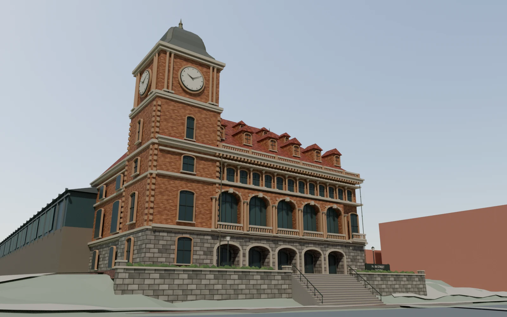
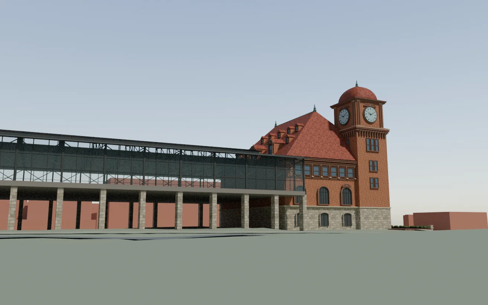

# Main Street Station landmark



The upper arcade opens onto a continuous coffered loggia. Its wood sash sit about three meters behind the columns. The ground floor uses low segmental stone arches and deeply inset doors, with a wide stair and multiple handrails. Above, the roof has larger ornamental dormers mixed with smaller ones, finials and an east chimney. The clock tower has paired and tripled windows, a deep corbelled cornice, blue dials and a round red-clay cap. Ornament and forecourt dimensions are estimates informed by the supplied exterior photos and historic records. [Historic American Buildings Survey](https://tile.loc.gov/storage-services/master/pnp/habshaer/va/va0500/va0562/data/va0562data.pdf) · [Virginia Department of Historic Resources](https://www.dhr.virginia.gov/historic-registers/127-0172/) · [Amtrak's station history](https://www.greatamericanstations.org/stations/richmond-main-street-station-va-rvm/)




The restored train shed includes independently shaded glass walls, steel X-bracing and visible cross trusses, and a glazed roof monitor. The Roman brick, foundation stone, roof clay and plaza pavers use original procedural color and tangent-space normal maps. The supplied photos were observed as references. The assembled scene also includes the pilot's neighboring building volumes. [© OpenStreetMap contributors, ODbL 1.0](https://www.openstreetmap.org/copyright)

## Coordinate match

The archived FBX uses east, north and up relative to the original vehicle start. The placement script restores the original spawn offset, reconstructs the geographic coordinates and projects to the pilot UTM grid. The old and new building rings have **99.8462% intersection over union**. A local affine fit reproduces the full nonlinear projection at the old outline vertices to within **0.003 m**. These measurements describe agreement between the two footprints and projections.

The preview anchors the clock-tower base to the current DEM. The detailed headhouse follows the archived building frontage and uses a placement matrix equivalent to the Blender scene's saved position, rotation and scale. The documented overlap applies to the audited footprint outlines. The render path checks the Blender-imported extents against the published local frame, verifies that both exports use the same terrain and footprint hashes, and removes the duplicate mass.

The tower's draft shaft is 6.51 m wide, 15% narrower than the preceding mesh. The finial is 34.45 m above the model's local zero, up from 31.58 m. The southwest foundation corner and the height of the stone-to-brick course are fixed. The headhouse cornices meet the revised shaft and the clock dials stay circular. These are model dimensions chosen for the visual proportions in the reference photos.

## Build the preview

First build the [combined mesh](Pilot_Mesh_Preview.md) from the same checkout. Put the audited `Richmond_Unreal_First_Drive.zip` in `inputs/`.

```shell
python tools/run_task.py S1-06 -- python tools/plan_pilot_station.py
blender -b --factory-startup --python-exit-code 1 --python tools/render_pilot_blender.py -- \
  outputs/pilot-mesh-preview/RVA_Pilot.obj outputs/station-detail/Street.png \
  --station-bundle inputs/Richmond_Unreal_First_Drive.zip --station-alignment reports/pilot_station_alignment.json \
  --station-view street --samples 80 --save-blend outputs/station-detail/RVA_Main_Street_Station.blend \
  --station-glb outputs/station-detail/RVA_Main_Street_Station_Exterior.glb
python tools/run_task.py S1-07 -- blender -b outputs/station-detail/RVA_Main_Street_Station.blend \
  --python-exit-code 1 --python tools/verify_station_detail.py -- outputs/station-detail/RVA_Main_Street_Station_Exterior.glb
```

Use `--station-view entrance` for the close render or `--station-view rail` to see the glazing and return elevations. Add `--build-only` to export assets without rendering. Omitting `--station-view` keeps the initial archive landmark view available as a placement check.

The `.blend` opens as an assembled scene with the original material maps packed. The GLB contains six exterior assemblies and eight embedded maps, with standard glTF Y-up axes. Its origin is the southwest corner of the headhouse's main block. The sidecar JSON maps the original Blender model-local XYZ in meters to the pilot's east, north and up coordinates. Blender reopened the scene and reimported the GLB. The station shed deck is a visual approximation. The [separate viaduct overlay](Station_Viaduct_Preview.md) previews nearby I-95 and Bellwood rail elevations, with the hidden rail span marked as an estimate. Exterior collision, LODs and the Unreal drive still need target-editor checks. [Placement evidence](../reports/pilot_station_alignment.json)
