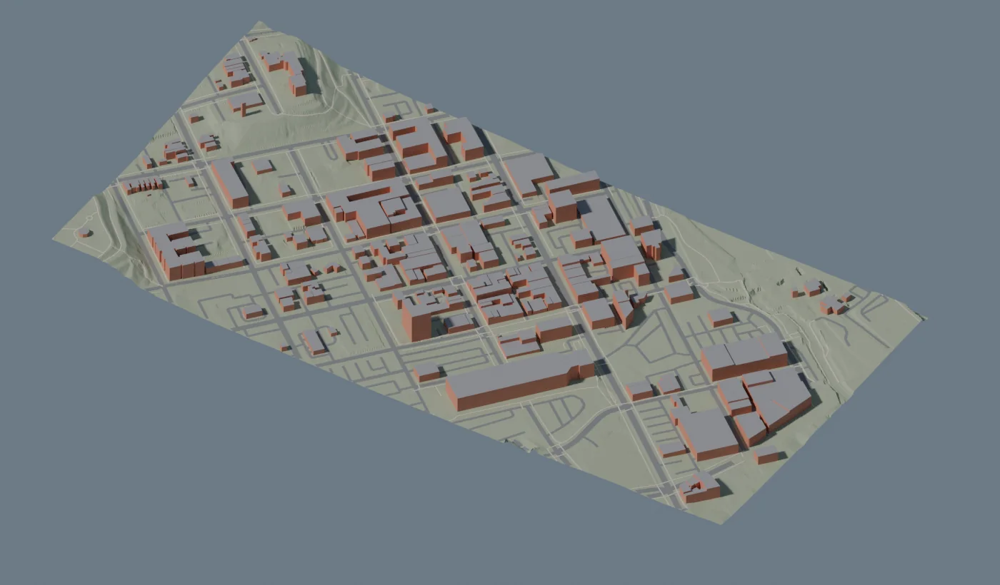

# Western Richmond mesh preview



This view combines the western two-tile terrain, mapped routes and 280 block-scale building volumes around Shockoe Bottom and Main Street Station. Building geometry uses the mapped footprint and the first-pair relative height estimate. The 31 unresolved buildings and 119 grade-separated street edges remain out of the mesh. Walls and roofs use simple materials for checking street spacing, elevation and building scale. [© OpenStreetMap contributors, ODbL 1.0](https://www.openstreetmap.org/copyright)

## Build and view

Run the [street graph](Pilot_Street_Graph.md), [building heights](Pilot_Building_Heights.md) and [terrain preview](Pilot_Terrain_Preview.md) exports from the same checkout. Then run:

```shell
python tools/run_task.py S1-05 -- python tools/build_pilot_mesh_preview.py
blender -b --factory-startup --python-exit-code 1 --python tools/render_pilot_blender.py -- outputs/pilot-mesh-preview/RVA_Pilot.obj outputs/pilot-mesh-preview/RVA_Pilot.png
```

Open the OBJ with its adjacent MTL to inspect individual buildings in Blender. Use **−Y Forward**, **Z Up**, and a scale of **1**. The scene uses local meters with X east and Y north. Keep the [pilot axis and origin contract](Pilot_Data_Contract.md) when converting it to Unreal centimeters. Blender 4.3.2 imported and rendered the reference mesh. [Blender OBJ import options](https://docs.blender.org/api/current/bpy.ops.wm.html#bpy.ops.wm.obj_import)

The terrain surface uses a two-meter mesh for inspection. The one-meter R16 tiles remain the source for Unreal Landscape. Road widths are initial class-based assumptions and the roads follow the visible terrain triangles. Production work still needs bridge decks, collision checks, and the first authored façades and landmarks.
