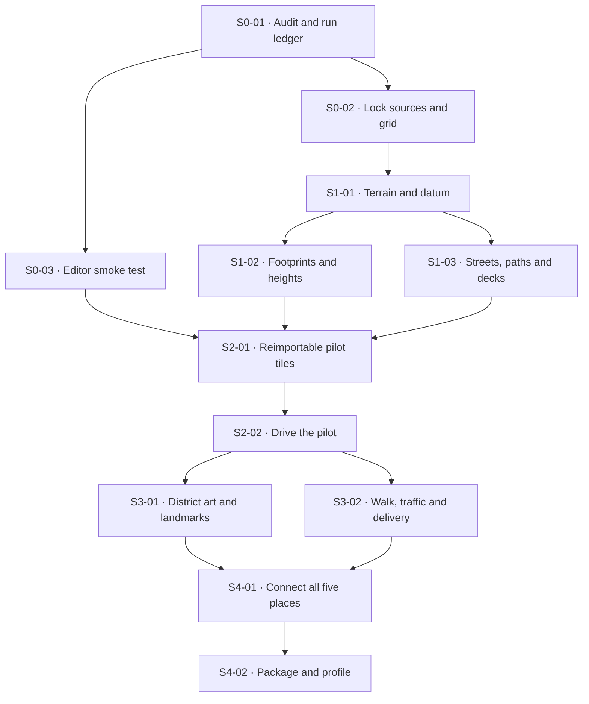

# Richmond Open World
## Unreal architecture and Sol build plan · Revision 1

**Build the east-side drive first.** Start at street level in Shockoe Bottom, where Main Street Station’s clock tower and train shed establish the location, then climb into Church Hill past St. John’s and end at the Libby Hill overlook. Use the existing checkpoint course as a separate fixed regression drive. Once both routes work on the same ground, road and building system, extend west to The Fan and Monument Avenue. Reach Belle Isle by parking on the north bank and crossing the pedestrian bridge on foot. The bridge below the Lee Bridge and the island’s granite and wooded trails make it a distinctly Richmond destination. [Belle Isle access and geography](https://jamesriverpark.org/explore-the-park-belle-isle/)

**Release goal.** A single-player, offline desktop vertical slice with a car, on-foot movement, a connected road network, light traffic and one complete delivery. “San Andreas-level” is an art direction target. Turn it into tests for recognizable places, detail visible from a moving car, collision and frame pacing. GTA V fidelity has no defensible estimate until one finished block has been timed and profiled on the target PC. These five sprints define dependencies and review gates. They carry no assumption about sprint length or staffing.

### 1. The starting build

I inspected the current first-drive archive and browser build. Use these numbers to detect regression and to identify which version a later Sol run received.

| Existing asset | What it provides | How to use it |
|---|---|---|
| Unreal first-drive ZIP, revision 2 | 12 FBX meshes, 28 original 512-pixel texture maps, editor Python importers, landmark references and route CSV | Retain as a read-only reference. Reuse the landmark meshes and materials after checking their placement, scale, pivots and collision in the new level. This is an import kit. Editor import and vehicle playtesting are open gates. |
| Church Hill–Shockoe course | Final CSV chainage 2,058.072 m, three checkpoint positions, a 16 m terrain grid and an OSM footprint/road extract | Keep the original course as a scale, speed, slope and camera regression. A newly mapped showcase drive can follow a different route. |
| Height file | 4,075 LiDAR matches among 4,494 footprints; 419 unmatched. The old file joins by array position. | Freeze each ordered input and hash it before migration. Assign stable feature IDs from the new extract. Check spatial overlap and record ambiguous matches. Re-estimate unmatched heights with provenance. |
| Browser driving test, revision 4 | Runnable reference for the existing loop, car speed display, hills and landmark viewpoints | Compare route length and fixed views. Develop gameplay and collision in Unreal. Browser and Blender results have their own evidence labels. |

The archive’s SHA-256 is `cbb7f8614cca769ceedab61c218d71941b9493de3fe0e3009be4ebe8516d71bc`. The HTML’s is `4164028e870f8fa651e70beefa01decb2080a37c509a6bbeaa31d291ddbe707f`. Preserve newer user revisions if those hashes change.

### 2. System architecture

| Owner of the data or behavior | Interface with the next system | Design decision |
|---|---|---|
| **Source catalog** · Python, local files, QGIS for inspection | `data/catalog.json`, canonical project grid, district polygons and an input lockfile | Keep URL, publisher, release or capture date, retrieval date, exact object IDs, byte hashes, footprint extent, horizontal and vertical reference, units, license and credit for every input. Store large downloads outside Git. A standalone run uses the local cache. |
| **Offline GIS build** · GDAL/PROJ, PDAL, QGIS, Python | `terrain/*.tif` and R16 height tiles, `world.gpkg` with named vector layers, `tile_manifest.json` and QA report | This is the source of truth for positions, access, heights and persistent IDs. Terrain, façades, road splines, collision, routing, HUD and QA consume the same coordinates. |
| **World assembly** · built-in Unreal Editor tools and Python | World Partition map, Landscape, generated actors by tile, shared module library, Data Layers | The Vehicle template supplies a starting car. Use a World Partition map for the new world. Re-import only changed tiles by content hash. Place authored landmark and gameplay overrides in a separate layer keyed by feature ID. |
| **City art** · Blender and editor-time PCG | Roof and wall shells, façade modules, prop instances, landmark meshes and distant HLODs | Geometry supplies silhouette, depth at doors and windows, stoops and parapets. Reusable materials supply mortar, grain, grime and wear. Bake the static PCG results. Generate from stable seeds. |
| **Sandbox** · Unreal Blueprints, Chaos Vehicles, character movement, optional MassEntity | Possession and camera, road and pedestrian graphs, route events, save slot and HUD | Keep navigation rules separate from meshes. Player vehicle uses physics. Nearby traffic follows directed lanes, stop lines and signal state. Spawn/despawn by distance. Add MassEntity only if measured agent counts justify a second representation. |
| **Verification and run history** · Python and Unreal tools | `reports/runs/`, `reports/qa/`, `DEV_STATE.md` | A card passes on observed evidence. Track GIS checks, editor checks, packaged-game checks and visual review separately. A missing editor blocks the engine check while GIS and artwork can continue. |

Use built-in World Partition streaming with one file per actor. Separate terrain/water, transport, buildings, dress, landmarks and gameplay by Data Layer. Start with a 256 m runtime cell and 768 m loading radius as profiling hypotheses. GIS tiles and streaming cells serve different purposes. Keep rail viaducts and landmark silhouettes visible across cells using HLODs. Store soft references or stable IDs across cell boundaries. A road graph that persists outside streamed render cells keeps route progress stable. [World Partition](https://dev.epicgames.com/documentation/en-us/unreal-engine/world-partition-in-unreal-engine) · [HLODs](https://dev.epicgames.com/documentation/en-us/unreal-engine/world-partition---hierarchical-level-of-detail-in-unreal-engine) · [PCG generation modes](https://dev.epicgames.com/documentation/en-us/unreal-engine/using-pcg-generation-modes-in-unreal-engine)

**Spending boundary.** Use existing hardware and local storage, local Git, the free GIS/Blender/Python toolchain, Unreal’s built-in features and template content. The plan uses no metered API, hosted inference, paid service, paid kit or remote build farm. Unreal is the source-available engine exception to the open-source toolchain. Epic offers game development access at no upfront cost and has royalty terms for revenue-generating games. The budget here covers the local prototype. Pin the actual installed UE patch, project/plugin settings, tool versions and target hardware when observed. If the machine cannot run the target profile, lower settings and record what it achieved. [Epic game licensing](https://www.unrealengine.com/uses/games) · [Vehicle template](https://dev.epicgames.com/documentation/en-us/unreal-engine/vehicle-template-in-unreal-engine)

### 3. From free data to a drivable Unreal tile

| Input | Use | Source and rights workflow |
|---|---|---|
| 2025 Richmond bare-earth DEM | Terrain and ground-elevation reference | NOAA lists a 1-foot hydro-flattened raster in the city collection. The published native DEM metadata specifies Virginia South US survey feet and NAVD88 US survey feet, and lists CC0. Freeze the exact downloaded product. [Richmond DEM and license](https://www.fisheries.noaa.gov/inport/item/80311/full-list) |
| 2025 Richmond classified point cloud | Roof, ground and bridge-deck samples | NOAA documents classes 2 (ground), 6 (building) and 17 (bridge deck). Prefer the specific geoid18 bulk delivery listed in NAVD88 meters. NOAA also documents an ellipsoidal processing path. Verify the actual delivery and file header. [Richmond point cloud, processing and access](https://www.fisheries.noaa.gov/inport/item/80312) |
| OSM Virginia extract | Primary roads, turn restrictions, crossings, building footprints/parts, water and paths | Download a dated Geofabrik PBF once; preserve source IDs and snapshot hash. Credit © OpenStreetMap contributors in-game and in the data bundle. On public use, provide the required ODbL notices and applicable derivative database or means of obtaining the alterations. Keep source lineage through exports. [Virginia extract](https://download.geofabrik.de/north-america/us/virginia.html) · [OSM copyright](https://www.openstreetmap.org/copyright) · [OSMF on produced works](https://osmfoundation.org/wiki/Licence/Community_Guidelines/Produced_Work_-_Guideline) |
| Virginia Road Centerlines | Independently check road coverage, geometry and names. Fill a confirmed gap with a source-tagged segment. | The VGIN metadata lists CC0 and credits VGIN. Retain original IDs and prevent duplicate roads during conflation. OSM remains the first source for driving/access tags and turn restrictions. [VGIN centerlines and terms](https://www.arcgis.com/sharing/rest/content/items/cd9bed71346d4476a0a08d3685cb36ae/info/metadata/metadata.xml?format=default&output=html) |
| USGS 3DEP | Terrain fallback for a verified coverage gap | Use the best available compatible product, record its date and resolution, feather only inside a documented overlap, and surface the lower confidence in QA. [USGS elevation collection](https://data.usgs.gov/datacatalog/data/USGS%3A4f34caac-f28f-4ea0-8d82-eafb2b8f9a5d) |
| Original materials, CC0 surfaces and dated heritage references | Façade materials, silhouette and architectural proportions | Begin with the archive’s 14 material families. Use directly downloadable CC0 surfaces when they improve the close view; record the asset URL and license. Consult public historic surveys and rights-cleared images for architecture. Google Street View and Apple Look Around supply no game textures or geometry in this pipeline. [ambientCG terms](https://docs.ambientcg.com/license/) · [Main Street Station survey](https://www.loc.gov/item/va0562/) · [St. John’s survey](https://www.loc.gov/item/va0578/) |

**Step A · Fix coverage, scale and datum.** Draw five district masks and connecting corridors in QGIS. Start with only the east-side pilot plus a buffer. The [pilot data contract](Pilot_Data_Contract.md) defines the 12 terrain tiles, the processing halo and the control intersections. Lock a canonical horizontal projection (proposed NAD83 / UTM 18N, EPSG:26918, meters) and vertical reference (NAVD88 meters, EPSG:5703). Use the legacy map origin, WGS84 longitude −77.4215°, latitude 37.5315°, projected once to E₀,N₀. Set H₀ to 0 m NAVD88. In UE centimeters, X = 100(E−E₀), Y = −100(N−N₀), Z = 100(H−H₀). The driving spawn has its own offset. Map legacy coordinates through the documented spawn and axis transform. Some legacy mesh coordinates are relative to the spawn. Apply the importer axis conversion exactly once. Unit-test one point 100 m east, one 100 m north and one 1 m above the origin. Validate three independently identified, non-collinear street intersections end-to-end in UE, with a proposed 2 m horizontal tolerance for corresponding source points.

**Step B · Normalize before combining datasets.** Read delivered GeoTIFF and LAS/LAZ headers. Log CRS, units, no-data, horizontal operation and geoid grid used. Use PDAL/GDAL/PROJ to transform to the agreed frame. If a NOAA delivery is ellipsoidal, apply the verified vertical operation to NAVD88 or request an orthometric export. Converting feet to meters alone cannot reconcile the two. Use the US survey foot conversion where declared. Test clear, near-level pavement with paired transformed class-2 samples and DEM values. Pilot gate: median absolute difference ≤0.30 m across at least 20 distributed, non-water locations, and investigate each residual over 1 m. Missing transformation grids or unresolved datum means the affected tile is blocked. [Point cloud processing history](https://www.fisheries.noaa.gov/inport/item/80312) · [DEM reference systems](https://www.fisheries.noaa.gov/inport/item/80311/full-list)

**Step C · Cook the terrain.** Mosaic with a processing halo, resample once to a city-anchored 1 m grid and retain Float32 GeoTIFFs as the master. Export 505 × 505 16-bit vertices for a 504 m square (4 × 4 components, 2 × 2 sections per component, 63 quads per section). Adjacent exports sample the same border vertices. For the proposed vertical settings, encode sample = 32768 + round(128 × (H−H₀)); Landscape uses XY scale 100 cm and Z scale 100. Check min/max before encoding; reject overflow. Use one vertical offset and scale for the entire world. Reject unresolved no-data and verify a known sample after UE import, including north/south orientation. Model water, banks and bridge decks separately. The bare-earth surface beneath a spanning bridge cannot give a car its deck elevation. [Landscape component sizing](https://dev.epicgames.com/documentation/en-us/unreal-engine/landscape-technical-guide-in-unreal-engine) · [Heightmap formats and scaling](https://dev.epicgames.com/documentation/en-us/unreal-engine/importing-and-exporting-landscape-heightmaps-in-unreal-engine)

**Step D · Extract building height with confidence.** Resolve OSM multipolygons, inner courtyards and building parts. Preserve source ID, geometry hash, parent ID and epoch. For each footprint, sample class-6 roof points inside a slight inset and estimate local ground from bare earth along the perimeter. Preserve a second street-front/street-entry ground measurement for steps and foundations on steep streets. Start with a roof P90 and median perimeter ground as the representative structure height. Store roof P50/P90/P98, ground range, sample and occupied-cell counts, method and confidence. Use robust split-roof/part statistics for stepped roofs. Never use the highest return as a universal eave or force an uphill townhouse to meet a flat curb.

Apply a low-confidence flag for sparse roofs (initial rule: fewer than 10 class-6 points or under 30% occupied 1 m footprint cells), temporally mismatched polygons, slivers, strong ground gradients or inconsistent heights. Fall back in order to a reliable tagged height, tagged levels × a documented local floor-height estimate plus roof allowance, then district median. Preserve a separate steeple/tower override where the landmark justifies it. Review 30 stratified buildings against held-out point-cloud cross-sections, including five slopes or complex roofs. Aim for median absolute roof difference ≤1 m on this measured subset. Publish the fallback count as its own metric.

**Step E · Build roads and paths from one topology.** Preserve stable segment IDs, one-way direction, access mode, layer, bridge/tunnel, name, lane count and source. Split at genuine same-grade junctions. Record an explicit junction ID, lane directions, turn permissions, stop lines, sidewalk links and pedestrian crossings. Use OSM width/lanes where present; keep a per-class width assumption wherever values are inferred. Convert these to Unreal splines with simplified control points and a maximum fitting error (pilot target 0.35 m against the source centerline). Generate crowned road meshes, intersections, curbs, sidewalk ramps, collision and lane markings from the same cross-sections. Elevate normal roads from the terrain, smooth noisy longitudinal grades and tie intersection ends to a common surface. Carry bridges on independent deck profiles from class 17 or reviewed approach/clearance measurements. Keep rail, vehicle and pedestrian levels distinct. Give shared seams a single vertex owner and verify collision there.

**Step F · Package for repeatable import.** Keep a GeoPackage with `building`, `building_part`, `road_edge`, `junction`, `path_edge`, `water`, `district`, and `landmark_override` layers. Flat JSON/CSV exports carry only the fields needed by UE. Each tile manifest specifies grid indices, bounds, neighbor IDs, shared-edge hashes, transforms, source hashes, generator/rules versions, feature IDs, counts and quality flags. Clip render geometry by tile, retain logical feature identity across fragments, and load facades/props by deterministic tile ownership. Import with a project-owned editor script. Stage changed assets, validate them, then replace generated content in its own namespace. A failed tile leaves the last good import and each authored override intact. Run an unchanged import twice: identical feature counts, transforms and asset paths; zero new duplicate actors.

### 4. A façade system that reads as Richmond

A façade rule chooses a **street-facing edge**, determines entrance elevation, fits an integer number of bays, selects ground-floor and upper-floor modules, then adds the roof and edge details. Prefer mapped entrances/addresses and compare against the street hierarchy before using the nearest walkable edge. Party walls suppress side windows. Corner buildings may have a second frontage and a cut or chamfered entry when appropriate. Key the random seed to district, building ID and rule version. Manually locked components survive regeneration.

| Place | Recognizable street-level composition | Treatment reserved for this place |
|---|---|---|
| **Church Hill** | Narrow brick and frame fronts, sash windows, raised stoops, iron rails, retaining walls, interrupted grade along the row | Step individual foundations with the hill. Protect the St. John’s belfry sightline and Libby Hill river view. Use shared cornice heights by row with restrained variation. [St. John’s district](https://www.dhr.virginia.gov/historic-registers/127-0192/) |
| **The Fan** | Radiating streets, attached houses, repeated porch and bay-window rhythms, cornices, tree canopy and rear alleys | Follow the fan-shaped intersections and wedge parcels. Vary depth of bays and porches, including brick/stone combinations and occasional balconies. Preserve corner storefronts where evidenced. [Fan Area district](https://www.dhr.virginia.gov/historic-registers/127-0248/) |
| **Monument Avenue** | Two carriageways, broad planted median, setbacks and larger masonry façades | Make the median and circle geometry correct first. Compose stone bases, porticos and larger bays around fixed parcel widths. A contemporary setting uses date-checked circle contents; old survey photographs can depict removed monuments. [Monument Avenue district](https://www.dhr.virginia.gov/historic-registers/127-0174/) |
| **Shockoe Bottom** | Wide industrial brick bays, arched openings, parapets, loading openings, railway structures and a much larger train shed | Lock Main Street Station’s clock tower/train shed as authored pieces. Use industrial lintels, loading docks and restrained signs where supported. Verify street paving block by block. [Shockoe Valley and Tobacco Row](https://www.dhr.virginia.gov/historic-registers/127-0344/) · [Station survey](https://www.loc.gov/item/va0562/) |
| **Belle Isle** | Layered road and pedestrian bridges, flat granite, fast water, wooded paths and industrial remnants | Use shoreline, rock shelves and canopy spacing as primary silhouettes. Build an on-foot route with a real access transition from the north bank. Mask vegetation and props away from trail clearances. [Belle Isle](https://jamesriverpark.org/explore-the-park-belle-isle/) |

Start with a modest Blender kit: brick and clapboard bays, a storefront and loading bay, two bay-window profiles, tall sash, doors/transoms, stoop, porch, iron railing, balcony, stone base, lintel, cornice and parapet. Fit bay spacing to the footprint, allow remainder only in end bays, and constrain roof form by building type. Use flat/parapet, pitched/slate and stepped industrial roofs. Near the player, model recesses and balcony projections. At distance, collapse them into a baked façade/HLOD. Keep material scale in real meters. Use base color, normal and packed occlusion/roughness/metallic maps with trims and decals. Ivy is sparse seeded growth on selected side walls, with exclusion masks for windows and doors. Trees, signs, hydrants, crosswalks and signals come from mapped locations when available. Label invented dressing as procedural.

Use instanced meshes for repeated bays, railings and props. Try Nanite for substantial opaque landmarks or granite where profiling supports it. Keep simple collision meshes independent of render detail. Start with conventional opaque PBR surfaces, and use a Substrate variant for layered paint or wet brick only if the pinned engine and target machine meet the frame budget. Lumen is the optional high-quality lighting profile; retain a lower-cost lighting profile. Record render settings with every comparison. [Nanite](https://dev.epicgames.com/documentation/en-us/unreal-engine/nanite-virtualized-geometry-in-unreal-engine) · [Substrate](https://dev.epicgames.com/documentation/en-us/unreal-engine/substrate-materials-in-unreal-engine) · [Lumen performance](https://dev.epicgames.com/documentation/en-us/unreal-engine/lumen-performance-guide-for-unreal-engine)

### 5. Five-sprint dependency graph

The arrows show hard prerequisites. GIS development and the editor capability check can run independently. An editor or packaged-game gate requires evidence from that environment.



| Sprint | Deliverables | Exit evidence |
|---|---|---|
| **0 · Establish the baseline** | **01** Read-only archive audit, run wrapper and state history. **02** Freeze pilot AOI, sources/rights, transforms, three control intersections, process versions and fixtures. **03** On the actual PC, pin UE version, create an open-world test level, drive the template car and import one legacy landmark and scale marker. | Audit repeated; failure and retry logged. Transform fixtures pass. Separate dated editor log, screenshot of marker and landmark, hardware and quality settings. S1 can begin once 02 passes. |
| **1 · Build the geography** | **01** Cook adjacent landscape tiles and resolve vertical datum. **02** Extract footprints/heights with confidence. **03** Produce lane, sidewalk and deck graph with a pilot road, foot-only link and grade-separated crossing. | Exact shared-edge height codes and no unresolved no-data. Datum and 30-building audits as above. A graph test proves correct one-way travel, no turn across grade separation and no car route onto a designated foot-only bridge. |
| **2 · Drive the east-side slice** | **01** Import terrain, roads, collision, buildings and landmark overrides by tile. **02** Implement Chaos car, start/reset, grounded chase camera, odometer and HUD. Drive the reference course and the station-to-overlook showcase. | Two identical imports create no duplicates. Course length within 1% of the 2,058.072 m legacy route when measured using its original convention. On a straight 200 m course in 10 s, distance/time reads 44.7 mph ±1 mph; use actual velocity for instantaneous HUD speed. No falling through, wheel snag or camera clipping on the three checkpoint locations, a slope crest, a tile seam or a bridge deck. |
| **3 · Finish one neighborhood-scale experience** | **01** Complete the two eastern neighborhoods’ hero views and build representative Fan, Monument and Belle Isle sample blocks/scenes. **02** Add car exit/entry, walk camera, one delivery with restart, signals and capped route-following traffic. | Fixed views identify each setting without HUD or labels in a blinded five-way review (proposed gate: at least 4/5 correctly identified by each of two Richmond-familiar reviewers). Capture comparable daylight baselines. Complete, fail/restart and reload a delivery. Nearby traffic honors stop lines, player clearance and lane direction for a five-minute soak. |
| **4 · Connect, package and measure** | **01** Extend the pipeline to all five AOIs plus connecting corridors, landings and pedestrian links. Validate vehicle routing to the north-bank access and on-foot routing to Belle Isle. **02** Build HLODs, package the desktop build, profile and tune density and settings. | From a cold launch drive from Church Hill through Shockoe to The Fan and Monument Avenue, then reach Belle Isle on foot via the north bank; test the return transition too. Run a repeatable 10-minute streaming drive after shader warm-up. Initial target on the recorded PC: 1080p output, p95 frame time ≤33.3 ms and no more than two frames over 100 ms; record internal render scale, VRAM/RAM and CPU/GPU bottleneck. Log cold-start hitches separately. Verify offline startup, checkpoint reload, license credits and OSM data offer before distribution. |

**Gameplay ownership.** One player controller transfers possession between the character and the car. Put the player at a collision-checked door location on exit. A simple state machine tracks pickup, checkpoints, destination, completion and restart. Save stable feature/checkpoint IDs, valid spawn, vehicle state and course progress; restore by ID after streaming. Use SI units throughout simulation; convert cm/s to mph only at the HUD boundary. Apply the same road access masks to route planning, traffic spawning and destination selection. Start traffic on a small capped pool. Increase it or add a MassEntity/ZoneGraph adapter only after tracing the current bottleneck; traffic behavior still comes from the validated graph. [Vehicle template](https://dev.epicgames.com/documentation/en-us/unreal-engine/vehicle-template-in-unreal-engine) · [MassEntity](https://dev.epicgames.com/documentation/en-us/unreal-engine/overview-of-mass-entity-in-unreal-engine)

### 6. Sol Execution Manifest

Each task has one versioned JSON card. The accompanying **Sol_Execution_Manifest.schema.json** is the normative JSON Schema (Draft 2020-12). Keep the card in `manifests/<task_id>.json`. The card describes the work; observed status belongs to the run report and `DEV_STATE.md`. This separation lets retries and failure history coexist with one task definition.

| Required fields | Contract |
|---|---|
| `schema_version`, `task_id`, `sprint`, `title`, `owner`, `depends_on`, `goal` | Version 1.0. Task IDs use S0-01 to S4-99; suffix starts at 01. Sprint number matches ID prefix. List direct prerequisites. |
| `inputs[]` | Each entry records `ref`, `required`, `rights`. A path, snapshot ID or source contract must identify the input. |
| `deliverables[]`, `out_of_scope[]`, `steps[]` | Name each output path and purpose, list excluded work, and order the implementation steps. |
| `acceptance[]` | Give each test an ID, automated/manual method, procedure, explicit pass criterion and evidence path. Manual review records observer, environment and date. |
| `on_blocked`, `retry` | Explain how to preserve completed work and resume. Specify the idempotence check. |
| `constraints`, `state` | Fixed zero-dollar budget, paid services off, placeholder stubs prohibited. The run entry point must update `DEV_STATE.md` atomically on every run and recover interrupted records. |

A schema checker validates structure; a graph check verifies unique task IDs and acceptance IDs, matching sprint prefixes, existing prerequisites and acyclicity. A file scan plus executed acceptance checks guards against unfinished bodies and fabricated success. Validate a card before dispatch. A failed validation of an attempted run still gets a run record.

**Run contract.** The bootstrap establishes `python tools/run_task.py TASK_ID -- COMMAND ...` as the supported entry point. It adds RUNNING with a unique ID before invoking work. At exit it atomically updates the task and its chronological entry, writes the result and evidence pointer, and preserves earlier attempts and unrelated notes. PASS requires the card’s acceptance evidence. BLOCKED is for a named missing prerequisite. FAILED records an observed error. A hard-killed process cannot execute a finalizer; its persisted start record allows the next run to mark it INTERRUPTED once. Protect writes and avoid reclaiming a live run. Log fixture tests separately from actual tasks. The state report includes UTC times, input hashes, changed files, command, checks, known exit code, blocker and next runnable card. Unstarted implementation belongs on a future card; completed code contains no placeholder comments or stubs.

**Filled card for Sprint 0, Task 1**

```json
{
  "schema_version": "1.0",
  "task_id": "S0-01",
  "sprint": 0,
  "title": "Bootstrap run tracking and inventory the first-drive baseline",
  "owner": "ChatGPT Sol",
  "depends_on": [],
  "goal": "Prove Sol can rerun a task, record every outcome, and identify the exact Richmond bundle used for comparison.",
  "inputs": [
    {"ref": "Richmond_Unreal_First_Drive.zip", "required": true, "rights": "User-supplied baseline. Preserve the bundled source and attribution notices."},
    {"ref": "Richmond_Driving_Test.html", "required": false, "rights": "User-supplied comparison build. Read-only."}
  ],
  "deliverables": [
    {"path": "tools/run_task.py", "purpose": "Standard-library entry point; record start, finalize status and recover an interrupted run."},
    {"path": "tools/baseline_inventory.py", "purpose": "Read-only ZIP and optional HTML inventory."},
    {"path": "reports/baseline.json", "purpose": "Actual input hashes, archive contents, route and match statistics."},
    {"path": "reports/runs/", "purpose": "Per-run evidence including exit status."},
    {"path": "tests/test_bootstrap.py", "purpose": "Offline fixtures exercising the runner and inventory."},
    {"path": "DEV_STATE.md", "purpose": "Current task status, chronological history, evidence and next action."}
  ],
  "out_of_scope": ["Changing the input artifacts, downloading GIS, installing Unreal or building gameplay."],
  "steps": ["Inspect inputs and existing project conventions.", "Implement the runner and inventory, and exercise success, failure, interruption recovery and retries in isolated fixtures.", "Run the actual audit through the runner and inspect its evidence."],
  "acceptance": [
    {"id": "A1", "method": "automated", "procedure": "Test valid fixture twice and compare inventory digests.", "pass_if": "Two distinct run records; unchanged deterministic inventory; no input mutation.", "evidence": "tests/test_bootstrap.py and reports/runs/<run_id>.json"},
    {"id": "A2", "method": "automated", "procedure": "Exercise missing ZIP, damaged ZIP and an interrupted run using an isolated temporary project.", "pass_if": "Missing input is BLOCKED, damaged input is FAILED, stale RUNNING is recovered exactly once; each outcome has evidence; preserve observed exit codes and use null for an unknown interrupted exit.", "evidence": "tests/test_bootstrap.py and captured test output"},
    {"id": "A3", "method": "automated", "procedure": "Run the actual baseline through the entry point; cross-check inventory against the ZIP and perform the placeholder scan.", "pass_if": "Hashes and counts are computed, discrepancies are recorded, Markdown history contains the run, and changed implementation contains no placeholders.", "evidence": "reports/baseline.json, DEV_STATE.md and reports/runs/<run_id>.json"}
  ],
  "on_blocked": "Finish and test independent work; record the exact missing input, evidence and smallest resumption command.",
  "retry": "Same inputs reproduce baseline.json. A retry adds exactly one run record and preserves earlier history.",
  "constraints": {"max_new_spend_usd": 0, "paid_services": false, "placeholder_stubs": false},
  "state": {"path": "DEV_STATE.md", "entrypoint": "tools/run_task.py", "on_every_run": true, "atomic": true, "recover_interrupted": true}
}
```

### 7. Sprint 0 Task 1 handoff prompt

Act as the implementation engineer for a $0 Unreal driving sandbox set in Richmond, Virginia. Execute **S0-01 only**. Your deliverable is a working local task runner and a verified inventory of the existing first-drive prototype. Use the supplied workspace, the existing Python 3 standard library, and local Git if present. The task works offline. Keep the source ZIP and HTML read-only. Leave Unreal installation, GIS downloads and game changes for later cards.

1. Inspect existing project conventions and preserve user changes. Locate the supplied `Richmond_Unreal_First_Drive.zip` and optional `Richmond_Driving_Test.html` within the project or use supplied paths. If the required ZIP is missing, still finish the runner and its offline tests. End the actual audit as BLOCKED and give the precise rerun command.

2. Implement `tools/run_task.py`, `tools/baseline_inventory.py` and `tests/test_bootstrap.py`. Use this interface from the project root:
   ```text
   python tools/run_task.py S0-01 -- python tools/baseline_inventory.py --bundle "Richmond_Unreal_First_Drive.zip"
   ```
   Support `--html PATH` on the inventory command. Use the current interpreter for child Python commands where needed. Record the first live bootstrap with this runner, and use it for every later card run. Fixture tests must use temporary projects.

3. Update `DEV_STATE.md` **automatically on every run**, including retries, blocked inputs, test failures and child exceptions. Write RUNNING before starting the child. Finalize to PASS (0), BLOCKED (3, a specific missing prerequisite) or FAILED (other nonzero). Allocate a unique run ID, retain prior history and unrelated notes, and record UTC start/end, task, actual command, inputs or hashes, changed files, checks, evidence path, blocker and next action. Write per-run evidence to `reports/runs/<run_id>.json`. Use atomic replacement and coordinate writers. Handle normal interruption when possible. After a hard stop, the next invocation must reconcile the stale run to INTERRUPTED exactly once, without mistaking a live run for a dead one. An unknown child exit code stays null. Persist the initial bootstrap attempt or any unrecoverable pre-run error in the same ledger as soon as the workspace is writable.

4. Read the ZIP without executing its scripts. Generate deterministic `reports/baseline.json` from the actual bytes. Report SHA-256, archive member names, mesh/texture counts, route length from final CSV chainage, footprint count and count of valid LiDAR matches recomputed from the height records. Cross-check counts and route length with the bundled metadata, flag any discrepancy, and distinguish unavailable fields from measured zero. Include the optional HTML hash if present. Preserve the last successful report on failure and point failed runs to their own evidence. Reference values from the inspected bundle are 12 FBX, 28 PNG, 4,494 footprints, 4,075 matches and 2,058.072 m. Identify a different version by hash and report drift; never substitute the reference values for observed results.

5. Run offline tests for two successful runs, a missing ZIP, a corrupt ZIP, interrupted-run recovery, and preservation of prior state and input bytes. Exercise the actual audit through the runner. Scan new or changed implementation and tests for unfinished work. Ship zero `// TODO`, TODO/FIXME comments, stub bodies, dummy success paths or unimplemented branches. A real blocker belongs in `DEV_STATE.md`. Record the commands and observed results. On the initial run, capture test results in its evidence or run the tests as an additional explicitly recorded invocation. A fixture pass alone cannot mark the real audit PASS.

Return the actual task status, exact paths, observed counts, test results, evidence and one next action. Stop after S0-01. Do not claim an editor import, playtest, or benchmark from this audit.
