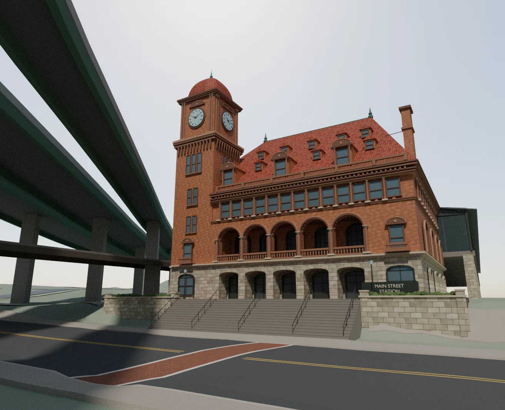

# East Main Street station approach



The approach covers about 143 m of East Main Street, from just west of 15th Street to just east of the headhouse. The station-side sidewalk meets the bottom tread. The concrete curbs lower at the station crossing, at the east-side 15th Street crossing and at the service driveway. The station crossing has a brick-paver surface and white boundaries modeled from the reference photos. Both sides of 15th Street use white boundaries on asphalt. Curbs, markings, ramps and street widths are preview dimensions. [© OpenStreetMap contributors, ODbL 1.0](https://www.openstreetmap.org/copyright)

The station crossing's mapped endpoints give a 14.625 m span in the headhouse frame. The new road and sidewalk faces split along the same two-meter terrain triangles as the site mesh. The exporter clips old ground ribbons to keep their connections outside the new footprint. Blender checks 19 surface heights, including four across the bottom stair and the three crossing centers. The I-95 and Bellwood meshes retain their own elevations and checks. [Approach geometry evidence](../reports/station_approach.json) · [Viaduct preview](Station_Viaduct_Preview.md)

## Build

Build the [pilot mesh and station GLB sidecar](Pilot_Main_Street_Station.md) and the [viaduct package](Station_Viaduct_Preview.md) first. With the default input locations:

```shell
python tools/run_task.py S1-09 -- python tools/build_pilot_mesh_preview.py \
  --station-frame outputs/station-detail/RVA_Main_Street_Station_Exterior.json \
  --output outputs/station-approach
python tools/run_task.py S1-09 -- blender -b --factory-startup --python-exit-code 1 \
  --python tools/render_pilot_blender.py -- \
  outputs/station-approach/RVA_Pilot.obj outputs/station-approach/East_Main.png \
  --station-bundle inputs/Richmond_Unreal_First_Drive.zip \
  --station-alignment reports/pilot_station_alignment.json \
  --station-view approach --station-decks outputs/station-decks \
  --save-blend outputs/station-approach/RVA_Station_Approach.blend --samples 44 --resolution 82
```

The OBJ/MTL contains the terrain and the dressed approach using east, north and up in meters. The assembled Blender scene adds procedural material detail. Use the [Unreal station smoke test](Station_Unreal_Smoke.md) to check import scale, road and stair collision, and the separation between street, rail and freeway.
