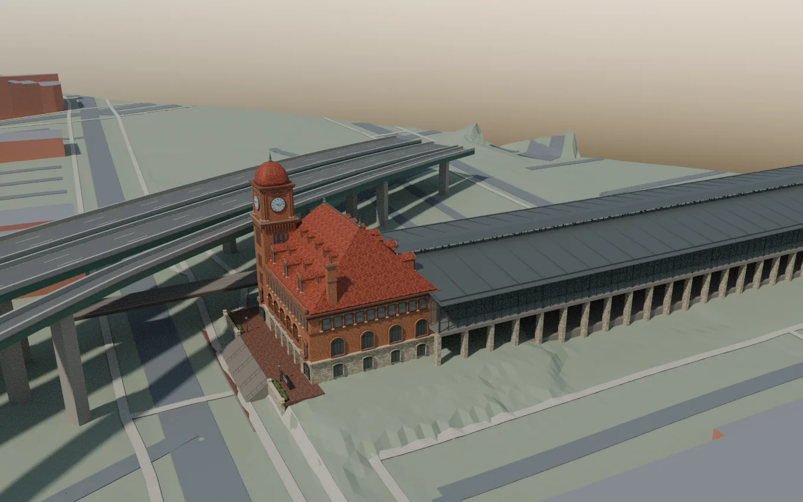

# Main Street Station viaduct preview



The preview adds roughly 204 m of each I-95 carriageway, 204 m of the eastern ramp, and 145 m of the Bellwood Subdivision rail trestle around East Main Street. The OpenStreetMap centerlines keep their positions and layers. Visual widths, girders, road markings, railheads and support positions are approximate. The wider motorway and rail connections end at the preview boundary. [© OpenStreetMap contributors, ODbL 1.0](https://www.openstreetmap.org/copyright)

## Evidence at East Main Street

| Structure | Top surface above the preview ground | Nearby LiDAR support |
| --- | ---: | --- |
| I-95 west carriageway | 20.10 m | 42 of 42 sampled stations observed |
| I-95 east carriageway | 20.55 m | 42 of 42 sampled stations observed |
| Eastern I-95 ramp | 20.70 m | 42 of 42 sampled stations observed |
| Bellwood rail trestle | 8.10 m | 18 of 31 sampled stations observed. The crossing sits inside a 67.83 m interpolation gap |

These measurements compare upper surfaces with the preview terrain at the centerline crossings. They do not establish clearance to an underside or document usable vehicle headroom. Each span uses the median of local class-17 returns within 2.4 m of its OSM centerline and a recorded elevation band to separate overlapping decks. The rail estimate interpolates between observed points on either side of the gap. Raw point elevations and missing observations are preserved in `station_decks.json`. [NOAA 2025 Richmond LiDAR](https://www.fisheries.noaa.gov/inport/item/80312) · [USGS LiDAR class table](https://www.usgs.gov/ngp-standards-and-specifications/lidar-base-specification-tables)

A station-only preview fit adds 1.348 m to the LiDAR profile for alignment with the cooked terrain. It used 212 ground witnesses, with a 0.080 m 95th-percentile absolute residual across 210 held-out witnesses. This check describes local ground agreement and does not measure the error of the occluded rail span. The source LAZ files, original terrain and regional vertical-datum hold remain in place.

[Street-level preview](../reports/Main_Street_Station_Beneath_I95.webp) · [Extraction evidence](../reports/station_decks.json)

## Reproduce

Use the locked LiDAR, OSM capture and projection grids from [the first-pair inputs](Pilot_Terrain_Preview.md). Build the [pilot mesh](Pilot_Mesh_Preview.md) and [station alignment](Pilot_Main_Street_Station.md) in the same checkout. For the default input locations:

```shell
python tools/run_task.py S1-08 -- python tools/station_deck_profile.py
blender -b --factory-startup --python-exit-code 1 --python tools/render_pilot_blender.py -- \
  outputs/pilot-mesh-preview/RVA_Pilot.obj outputs/station-decks/Viaducts.png \
  --station-bundle inputs/Richmond_Unreal_First_Drive.zip --station-alignment reports/pilot_station_alignment.json \
  --station-view decks --station-decks outputs/station-decks \
  --save-blend outputs/station-decks/RVA_Station_Viaducts.blend
```

The separate OBJ and MTL use east, north and up in meters, matching the pilot mesh. Blender checks the imported deck heights at the East Main crossings. The [street approach](Station_Approach_Preview.md) adds the curb and grade fit around the headhouse. Before enabling vehicle travel in Unreal, extend the deck ends to verified approach ties, resolve the rail gap and regional source datum, and test collision, clearance and streaming.
